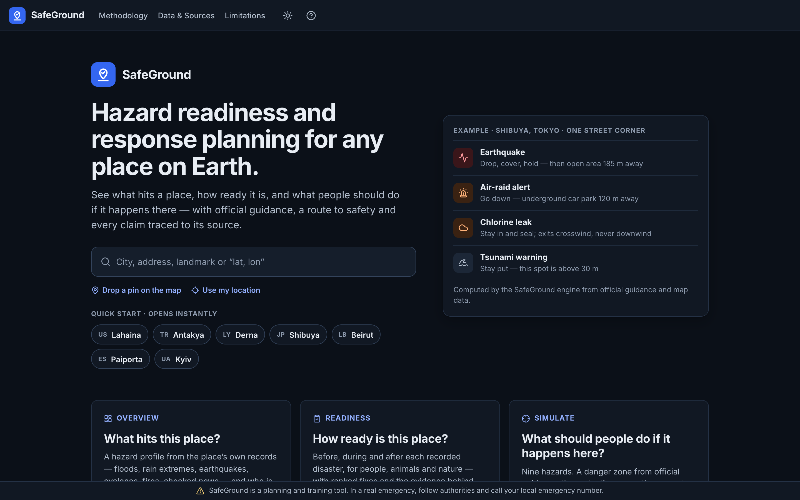
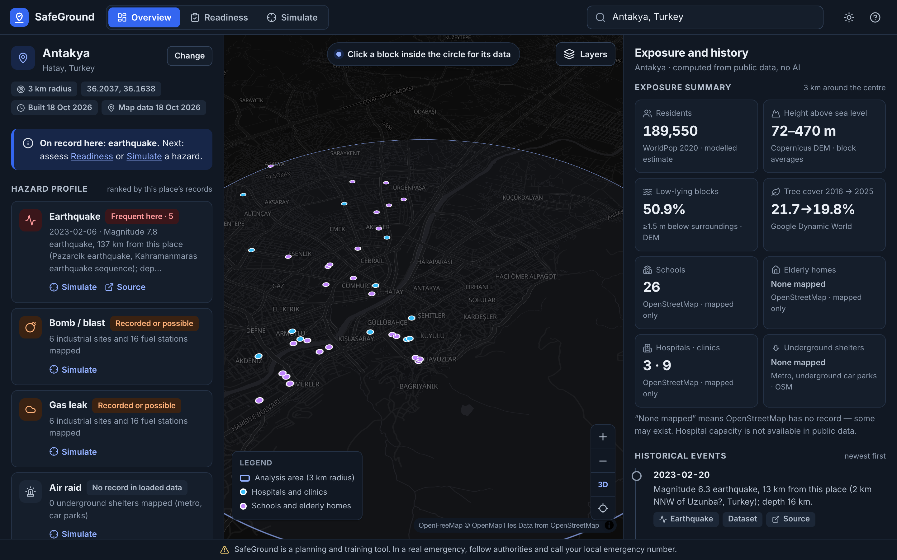
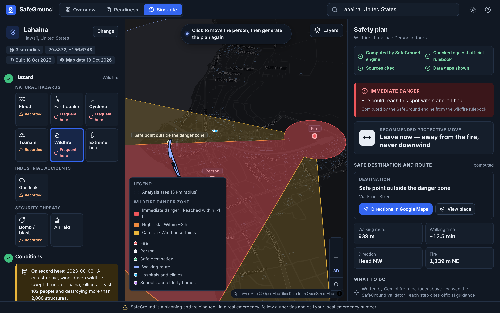
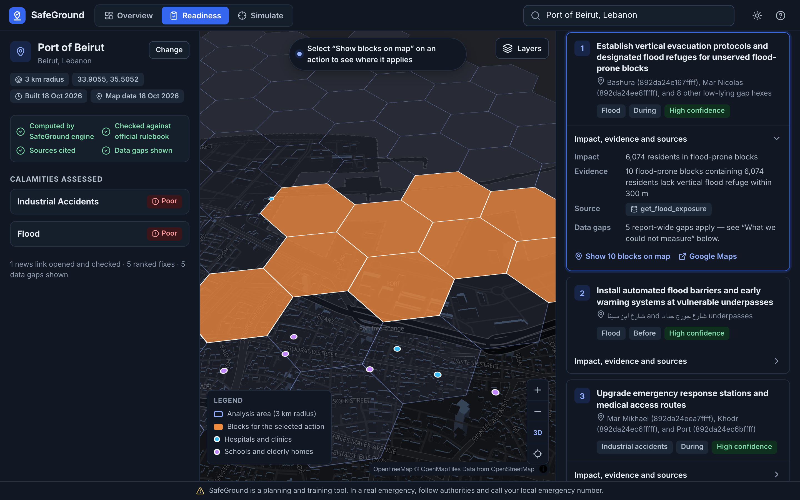
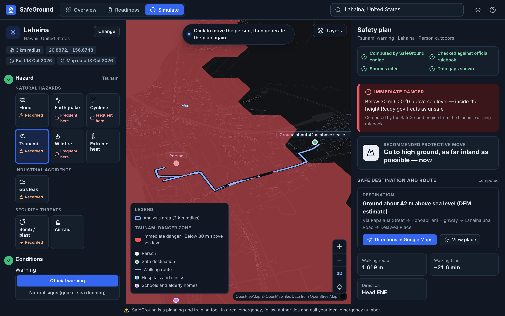
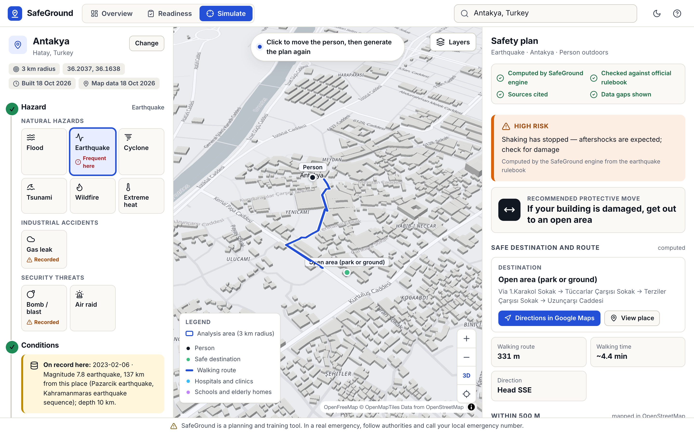
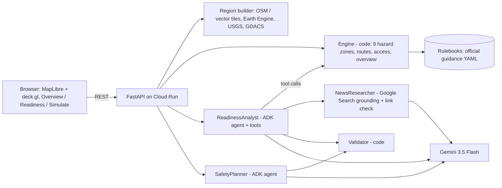

# SafeGround — hazard readiness and response planning for any place on Earth

**Google Cloud AI Builder Cup 2026 · Theme: Sustainability & Social Impact**

**Live platform:** https://safeground-653135417611.asia-south1.run.app (Cloud Run, asia-south1; the first load after idle takes a few seconds)

SafeGround is a planning platform for city planners, emergency managers, companies with sites to protect, and residents. Pick any place on Earth and it answers three questions:

1. **Overview: what hits this place?** It builds a hazard profile from the place's own records and shows who is exposed:
   - **Records:** Earth Engine flood and rain extremes, USGS earthquakes, GDACS alerts and link-checked news.
   - **Exposure:** residents, low-lying land, schools, elderly homes, hospitals and shelters.
2. **Readiness: how ready is it?** An AI investigator measures readiness **before, during and after** each recorded disaster, for **people, animals and nature**. It then ranks what to fix first, and every number traces back to a dataset.
3. **Simulate: if it happens here, what should people do?** You choose one of **9 hazards**, the conditions, a spot and a person's situation. SafeGround then:
   - computes the danger zone from official guidance;
   - picks the right protective move, the nearest safe place and a walking route that avoids the danger, with a **Google Maps directions link**;
   - writes a plain-language plan in which every step cites official advice.

> SafeGround is a **planning and training tool**. It does not detect incidents, send alerts or replace official
> instructions. In a real emergency, follow the authorities and call the local emergency number.

| Landing: search any place, quick starts | Overview: hazard profile, exposure, history |
|---|---|
|  |  |
| **Simulate: wildfire with wind (validated plan)** | **Readiness: ranked fixes with evidence on the map** |
|  |  |
| **Simulate: tsunami warning in Lahaina** | **Light theme: earthquake, after shaking** |
|  |  |

Deck: [`docs/SafeGround_deck.pdf`](docs/SafeGround_deck.pdf) · Demo script: [`docs/demo_script.md`](docs/demo_script.md)

## Nine hazards, one engine
Each hazard is a rulebook in [`safeground/rulebooks/`](safeground/rulebooks/). A rulebook holds:
- the zone model and the conditions the user can set;
- the danger levels, and the allowed and forbidden moves;
- official advice quoted word for word, each line with its source.

The UI builds the hazard picker and the condition controls from these files. Adding a hazard means adding a rulebook and a zone function.

| Hazard | How the danger is computed | Safe move and target | Guidance |
|---|---|---|---|
| Flood / heavy rain | Low-lying land (DEM), surface water, 24 h rain category; marked flooded streets override | Go up: tall building or higher ground, route avoids underpasses | State disaster-management do's and don'ts |
| Earthquake | Shaking now / after shaking | Drop, cover, hold on; afterwards nearest mapped open area | Ready.gov (FEMA) |
| Cyclone / hurricane | Low-lying blocks (surge or flooding) vs wind-only blocks; Saffir-Simpson strength | Go up or shelter in an interior room | Ready.gov, NOAA NHC |
| Tsunami warning | Height above sea level vs Ready.gov's 100 ft (30 m) | Nearest ground ≥ 30 m, as far inland as possible | Ready.gov |
| Wildfire | Fire point + wind: spread ≈ 10% of wind speed (1 h and 3 h zones) | Leave early, crosswind/upwind, never downwind | Ready.gov; Cruz & Alexander 2019 |
| Extreme heat | NWS heat index from temperature and humidity | Get cool; outdoors: nearest public building | Ready.gov, US NWS |
| Toxic gas leak | ERG 2024 Table 1/3 distances, wind-shaped | Shelter in place and seal, or move crosswind | ERG 2024, Ready.gov |
| Bomb threat / explosion | DHS/FBI stand-off distances, ERG | Evacuate or shelter away from windows | DHS/FBI chart, ERG 2024 |
| Air-raid / missile alert | Whole-area alert | Nearest mapped underground shelter | Civil-defence drill guidance |

The hazard picker is sorted by **this place's own records**: it marks what has happened here and what has been recorded nearby. Each plan also lists mapped schools, elderly homes and clinics within 500 m, because people there may need help first.

## Any place on Earth
Click the map or search a place. SafeGround builds a 3 km area live, which takes 1–2 minutes the first time; after that the area is cached.

| Step | Source |
|---|---|
| Place search and naming | Photon geocoder (OpenStreetMap) |
| Roads and facilities (hospitals, fire stations, schools, elderly homes, subway entrances, open areas, industry) | OpenStreetMap via the Overpass API. When Overpass is busy, the same data comes from **OpenFreeMap vector tiles**, decoded in [`vtiles.py`](safeground/engine/vtiles.py) |
| Population, building heights, elevation, water, land cover 2016→2025, protected areas | **Google Earth Engine**, computed live for ~300 hexagons ([`earth.py`](safeground/engine/earth.py)) |
| Past disasters | Earth Engine (Global Flood Database, CHIRPS / ERA5-Land rain extremes, FIRMS), **USGS** earthquakes, **GDACS** alerts, and Gemini + Google Search news with every link checked |
| Emergency numbers | A checked table per country ([`emergency.py`](safeground/engine/emergency.py)); no number is guessed |

These places open instantly: Paiporta (Spain), Shibuya (Tokyo), Port of Beirut, Antakya (Türkiye), Podilskyi (Kyiv), Lahaina (Hawaii) and Derna (Libya).

## Why it is different
- **Code computes, AI explains.**
  - Zones, distances, routes and counts come from deterministic code and public datasets.
  - Gemini (via Google ADK) chooses which checks matter, reasons over the results and writes for people.
- **Every AI answer is checked by code before anyone sees it.** The validator rejects any answer with:
  - a wrong danger level;
  - numbers that are not in the computed facts;
  - advice that is not in the rulebook;
  - unsafe moves, such as a basement in a gas leak, downwind in a wildfire, or the shore in a tsunami.

  Rejected answers go back to Gemini with the reasons. After 3 failed attempts, the official text is shown word for word.
- **Proactive and specific.**
  - The hazard profile and the hazard order come from the place's own history.
  - Each plan names a real safe place with a route and Google Maps directions, and lists who nearby may need help.
- **Honest about gaps.** Unknowns stay unknown and are shown: hospital capacity, basements, distance from the coast, and whether a building is open or cooled.

## Product and design
- **Landing page.** One large search box that takes a city, address, landmark or coordinates, or you can drop a pin. It also has seven quick-start places, three capability cards, a trust strip and "How SafeGround works".
- **Map-first workspace.**
  - A sticky header with the Overview / Readiness / Simulate tabs.
  - A left control panel, the map in the centre and a right results drawer.
  - The disclaimer is always visible.
  - Dark-first, with an off-white light theme; it also works on phones.
- **Computed facts first, AI second.**
  - Every result opens with a provenance badge: *Computed by SafeGround engine · Checked against official rulebook · Sources cited · Data gaps shown*.
  - Next come the danger level, protective move, destination, route and nearby schools and elderly homes, all computed.
  - Only then the plain-language plan, labelled as written by Gemini and validated.
  - Each step's citation opens the official text.
  - If validation fails, the narrative is withheld and the official guidance is shown word for word.
- **Simulate in five steps:** Hazard → Conditions → Location → Person profile → Safety plan.
  - Only the controls relevant to the chosen hazard appear.
  - Person presets: indoors, outdoors, mobility limitation, school group, pet owner, upper floor, vehicle.
  - Every location can be typed as coordinates, for keyboard users.
- **Plan actions:**
  - Directions in Google Maps
  - Print plan (a printable template)
  - Download PDF
  - Copy plain text
  - Share link, which reopens the same scenario
- **Honest states:**
  - Progress checklists while a place builds (1–2 min)
  - "Not available in public data" and "None mapped" labels
  - Calm error messages with a retry
- **Pages:** Methodology, Data & Sources, Limitations and Accessibility (WCAG 2.2 AA checklist).
- **Design system:** tokens, components, states and responsive rules are in [`docs/design/README.md`](docs/design/README.md).

## Architecture


## Run locally
```bash
python3.11 -m venv .venv && .venv/bin/pip install -r requirements.txt
cp .env.example .env            # add your own Gemini API key (never commit .env)
.venv/bin/uvicorn safeground.api.app:app --port 8810
.venv/bin/python -m pytest -q   # 22 tests: zones, thresholds, routes, validators
```
To build new places you need Earth Engine access for your Google Cloud project; set `SAFEGROUND_EE_PROJECT`.

## Evaluation
The evaluation ran 20 safety-plan cases at real street locations, covering flood, gas, explosion and air raid in five situations. Each case was run with the same Gemini model twice: once with SafeGround's computed facts and validator, and once alone. The full method, the cases and a change log are in [`eval/RESULTS.md`](eval/RESULTS.md).

| Check | SafeGround | Gemini alone |
|---|---|---|
| Danger level matches the official-distance tier | 100% | 30% |
| Main move allowed for that tier | 100% | 70% |
| Plans with invented distances/times | 0 | 3 |
| Plans with an unsafe instruction | 0 | 0 |

The five newer hazards (earthquake, cyclone, tsunami, wildfire, heat) each passed validation on the first attempt in a live test, and they are covered by unit tests ([`tests/test_hazards.py`](tests/test_hazards.py)). They have not been run through the 20-case comparison.

## Limitations and responsible use
- **Gas, explosion and wildfire zones**
  - ERG distances are designed for the first phase of transport incidents; for fixed facilities they are a screening estimate.
  - Bomb stand-off distances "do not guarantee safety".
  - Wildfire spread uses a published rule of thumb, not a fire-behaviour model.
- **Elevation-based tiers** (flood, cyclone surge, tsunami)
  - These come from a 30 m surface model with metres of vertical error, and are susceptibility estimates only.
  - Drain and built-over-wetland flooding is missed, which is why reported flooding overrides the estimate.
  - Distance from the coast is not measured.
- **Data coverage**
  - OpenStreetMap completeness varies; hospital capacity, basements and animals are poorly mapped.
  - Population and building heights are model estimates, and past-event lists are not complete.
- **Area limits**
  - Each place covers a 3 km circle; Google Open Buildings heights do not cover Europe or North America.
  - When map data comes from vector tiles, street names and hospital sizes are missing.
- **Guidance sources:** official advice comes from US (FEMA/Ready.gov, DOT ERG, NOAA, DHS) and Indian state sources; check local guidance.
- **Hosting:** places built on the live server are lost when it scales to zero; the listed places are permanent.
- **Privacy and responsibility:** no personal data is collected and no alerts are sent. Human authorities remain responsible for decisions.
